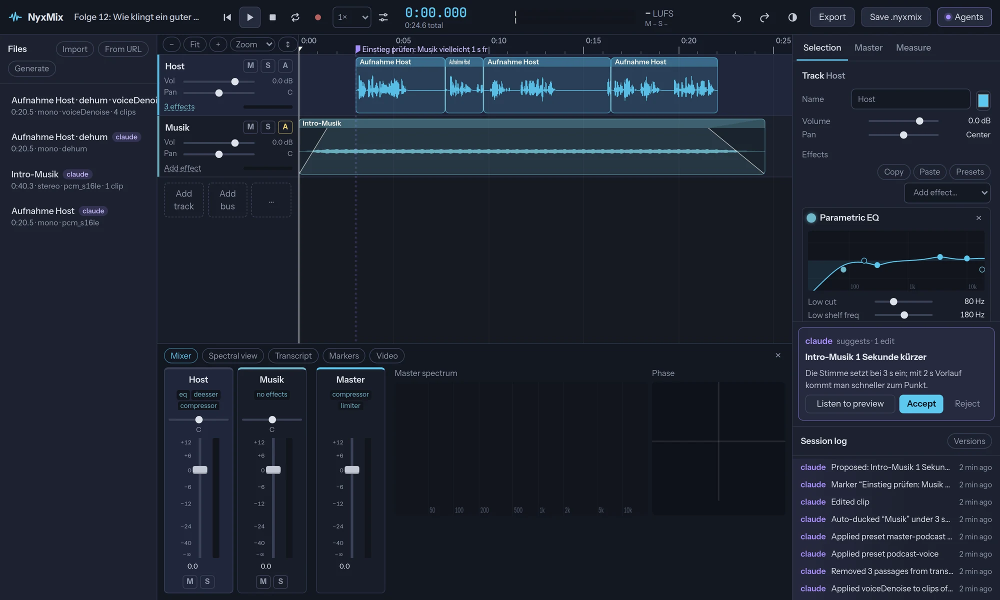
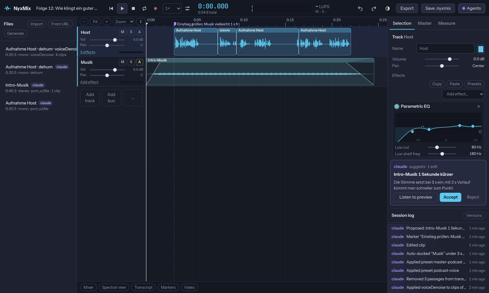
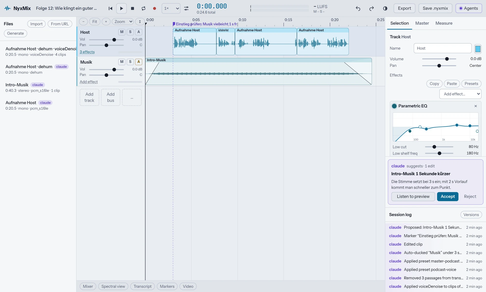
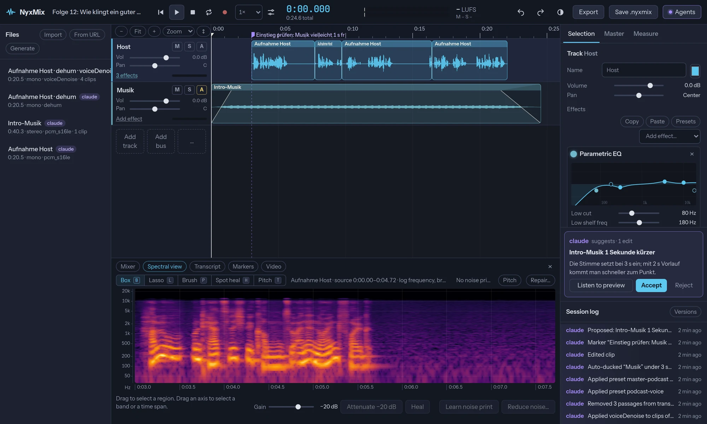
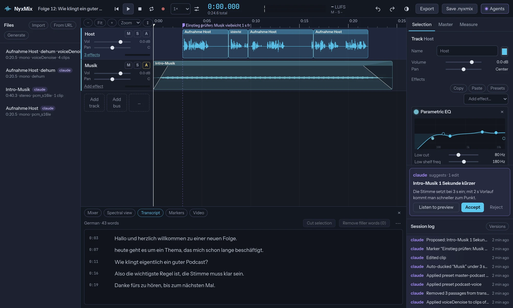
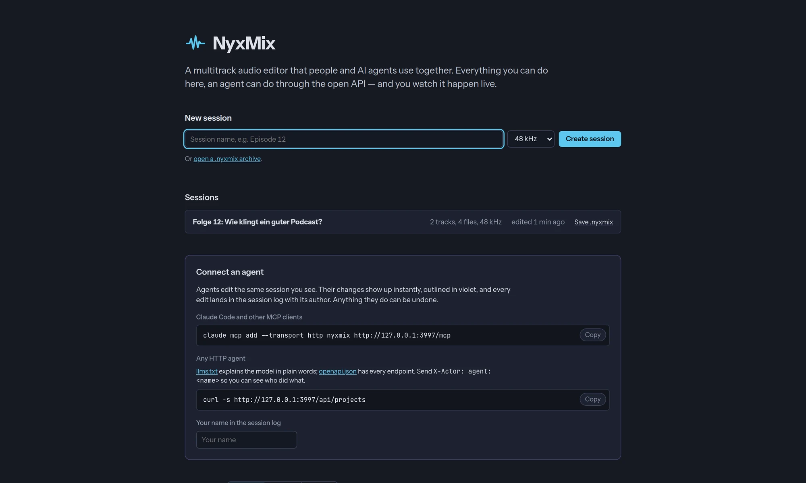

# NyxMix

**The open-source alternative to Adobe Audition, built for people and AI agents together.**

Multitrack editing, mixing, restoration, spectral repair, loudness mastering and podcast
production in your browser. Free, MIT-licensed, no subscription and no account.
Everything you can do in the UI, an agent can do through MCP or REST, and you watch it
happen live, see who did what, and can undo any of it.

> Checked feature by feature against Audition's official reference: of 65 Audition
> features, **50 have an equivalent, 14 go further, 1 is partial, none are missing**,
> and every row is backed by an automated test ([full comparison](docs/audition-comparison.md)).
> Audio output is verified against EBU R128 / ITU-R BS.1770 ([48/48 conformance tests](docs/conformance.md)).

<p align="center">
  
</p>

<p align="center">
  <a href="https://www.npmjs.com/package/nyxmix"></a>
  <a href="LICENSE"></a>
  <a href="https://registry.modelcontextprotocol.io/v0/servers?search=nyxmix"></a>
</p>

```bash
npx nyxmix   # then open http://127.0.0.1:3950
```

## Screenshots

| | |
|---|---|
|  |  |
| **Session view.** Here an agent cleaned up a rough podcast recording (hum, noise, filler words, pauses), labelled every step in the session log, and left a suggestion for you to accept. | **Light theme.** Follows your system, or switch it in the top bar. |
|  |  |
| **Spectral editor.** Paint out noises, heal spots, draw pitch curves. | **Transcript.** Edit speech by text, remove filler words in one click. |
|  |  |
| **Start page.** Sessions, `.nyxmix` files, and how to connect an agent. | **Mixer.** Faders, meters, inserts, master spectrum and phase scope. |

The demo session was made by an agent with [`examples/agent-demo.mjs`](examples/agent-demo.mjs), using nothing but MCP.

## Run it

```bash
npx nyxmix                               # http://127.0.0.1:3950, sessions in ~/.nyxmix
npx nyxmix --token secret                # require "Authorization: Bearer secret" (the UI asks once)
npx nyxmix --port 4000 --data ./sessions
```

Requirements: **Node 22+** and **ffmpeg 6+** on your PATH (with rubberband, libmp3lame, libopus,
which the usual ffmpeg builds have).

From a checkout:

```bash
npm install
npm start                      # same server, data in ./data
npm test                       # integration tests (they boot their own servers)
node examples/agent-demo.mjs   # an agent producing a podcast episode over MCP
```

### Optional extras

Everything below is optional; NyxMix works without it and tells you clearly when a feature needs one.
Python features use a `.venv` next to the package if there is one, otherwise `python3` on your PATH.

| For | Install |
|---|---|
| Pitch correction, pitch curve, remix, restoration extras | Python 3 + `pip install numpy scipy pyworld librosa` |
| Transcription / text-based editing | Python 3 + `pip install faster-whisper` (model via `NYXMIX_WHISPER_MODEL`, default `small`) |
| Text-to-speech (generate) | [Piper](https://github.com/rhasspy/piper) voices in `NYXMIX_PIPER_VOICES` (default `/opt/piper-voices`) |
| VST3 effects | Python 3 + `pip install pedalboard`, plugins in `~/.vst3` or `VST3_PATH` |
| LV2 effects | `lv2apply`/lilv and plugins in `LV2_PATH` |

### Settings

| Variable | Default | Meaning |
|---|---|---|
| `PORT` / `HOST` | `3950` / `127.0.0.1` | Listen address. Keep `127.0.0.1` unless you put a proxy with TLS in front. |
| `NYXMIX_TOKEN` | – | Bearer token for API, MCP and WebSocket. **Set it whenever anyone else can reach the server.** |
| `NYXMIX_DATA` | `./data` (`~/.nyxmix` with `npx`) | Sessions, audio, renders |
| `PUBLIC_URL` | request host | Base for absolute URLs handed to agents |
| `NYXMIX_PLUGINS` | off | `1` allows installing custom plugins (JS/Faust). **Plugin code runs on your server**, so only enable it if you trust everyone with access. |
| `NYXMIX_ALLOW_PRIVATE_URLS` | off | `1` lets URL import fetch private addresses (off by default: SSRF guard) |
| `NYXMIX_RENDER_THREADS` | CPUs − 1 (max 8) | Parallel render processes |

The older `KLANG_*` names still work.

## Sessions as files (.nyxmix)

**Save .nyxmix** (top bar) downloads a whole session as one file: lossless audio, arrangement,
effects, automation, markers, versions, undo history, transcripts, noise prints, reference
video and the custom plugins it uses. **Open a .nyxmix archive** on the start page restores it on
any NyxMix server; plugins it brings along are installed after the same checks as a normal install
(only where plugins are enabled, never overwriting a different plugin with the same id).

## Connect an agent

- **MCP** (Streamable HTTP): `claude mcp add --transport http nyxmix http://127.0.0.1:3950/mcp`
  (with a token: `--header "Authorization: Bearer secret"`)
- **REST**: `/openapi.json`, plain-language guide at `/llms.txt`
- **Live events**: `ws://…/ws?project=<id>`
- Send `X-Actor: agent:<name>`; the UI labels edits with it.
- Agent skill: [`SKILL.md`](SKILL.md)

## How it is built

- **One audio graph, two runtimes.** `public/js/engine/graph.js` builds the mix in the
  browser's `AudioContext` for playback and in the server's `OfflineAudioContext`
  (`node-web-audio-api`) for export and analysis. Custom DSP (limiter, gate, de-esser,
  saturation, BS.1770 loudness meter) lives in `engine/dsp-worklet.js` and runs as an
  AudioWorklet in both. What you hear is what you export.
- **Every edit is an operation** (`server/ops.js`): JSON-schema validated, applied
  atomically in batches (later ops can reference earlier results with `"$0.trackId"`),
  undoable, logged with its author, broadcast over WebSocket. The UI uses exactly the
  same calls as agents.
- **Lossless storage.** Imports become 32-bit float WAV at the session rate. The browser
  gets a 24-bit FLAC copy (same sound, ~10× smaller). Rendering and destructive
  processing run on the server in float.
- **Feature modules** in `server/features/*.js` register their own REST routes and MCP
  tools: auto-ducking, proposals and versions, transcription and text-based editing,
  spectral editing and noise-print reduction.

## What it does

**Editing** — multitrack timeline; move, trim, split, ripple-delete ranges, insert
silence, copy/paste, duplicate; snapping; automatic crossfades on overlap; fade curves
(linear, equal power, S-curve, exponential); clip gain; markers and range markers;
sample-level zoom; undo/redo; named versions.

**Mixing** — per-track effect chains (parametric EQ with draggable bands, compressor,
limiter, gate, de-esser, saturation, echo, reverb, gain) and presets; buses with output
routing and pre/post-fader sends; volume and pan automation; auto-ducking under speech;
mixer view; live peak/RMS meters and an EBU R128 loudness meter.

**Restoration** — neural voice denoise (RNNoise), FFT noise reduction, noise-print
reduction, hum removal, de-click, de-ess, gate, speech leveler, loudness match and
normalize, silence shortening, tempo and pitch (Rubber Band); spectral editor with box
selection, attenuate and heal; any process can run on a selected range only, with an
A/B preview before applying.

**Speech** — local transcription with word timestamps; delete words to cut audio;
language-aware filler word removal; pause tightening.

**Analysis** — integrated loudness, loudness range, true peak, sample peak, RMS,
clipping, DC, spectral balance, silences, RMS envelope, waveform and spectrogram images
(agents can look at them).

**Export** — WAV/FLAC (16/24/32-bit), MP3, AAC, Opus; loudness normalisation to a
target; markers as chapters; stems per track; bounce to a new file.

**Agents** — MCP server with ~70 tools, REST + OpenAPI, live sync, author on every edit,
proposals the person previews and accepts or rejects, versions to return to.

**Since the first version** — effect-parameter automation and clip volume envelopes;
16 more real-time effects (31 in all: multiband compressor, graphic EQ, multimode and
auto filters, expander, transient shaper, distortion, bit crusher, ping-pong delay,
pitch shifter, doubler, vocal enhancer, exciter, ring modulator, polarity/DC); true-peak
limiter; plugins (AudioWorklet modules, test-rendered before install, off unless
`NYXMIX_PLUGINS=1`); 5.1 surround with a surround panner and 6-channel export; video
track with synced picture, filmstrip, frame grabs and scene-change detection; spectral
lasso, brush, spot heal and pitch display; automatic pitch correction (WORLD vocoder);
de-clipper; clip stretch to an exact length; punch-in recording with monitoring and
measured latency compensation; delivery checks (podcast, EBU R128, ATSC, streaming,
ACX); export tags, chapters, stems and one file per range marker; session archives;
music remix to a target length (beat-matched jumps, editable as clips); manual pitch
curves drawn on the spectral pitch display; Generate menu (speech from text, tones,
noise, silence); undo history you can jump through; remappable shortcuts; goniometer
and phase correlation;
user presets; live spectrum analyzer; touch editing; parallel rendering on all cores
in crash-isolated processes.

## NyxMix vs. Adobe Audition

| | **NyxMix** | Adobe Audition |
|---|---|---|
| Price | **Free, open source (MIT)** | Subscription |
| Runs on | **Any modern browser**; the server needs Node 22 + ffmpeg (tested on Linux) | Windows, macOS |
| Multitrack, effects, automation, buses | ✅ | ✅ |
| Spectral editor, noise reduction, de-click, de-hum | ✅ | ✅ |
| Loudness (EBU R128, true peak), match loudness | ✅ | ✅ |
| Transcript-based editing, filler-word removal | ✅ | – |
| AI agents edit live (MCP + REST), every edit labelled | ✅ | – |
| Review agent changes before they land | ✅ | – |
| Several people/agents in one session at once | ✅ | – |
| Whole session as one portable file | ✅ `.nyxmix` | – |
| Native plugins live on tracks (VST/AU) | ≈ VST3/LV2 on the server | ✅ |
| Lowest monitoring latency (ASIO/Core Audio) | ≈ browser, with measured compensation | ✅ |


Output quality is measured against EBU Tech 3341/3342, ITU-R BS.1770-4 true peak and bit-exact null tests in [docs/conformance.md](docs/conformance.md) (48/48 pass).

The full, test-backed checklist against every effect and feature in Audition's official reference is in [docs/audition-comparison.md](docs/audition-comparison.md). Summary:

Where NyxMix goes further: an open API and MCP so agents can edit; live shared sessions
with authorship; proposals to review agent changes before they land; transcript-based
editing and filler removal; chapter export; it runs in a browser with nothing installed.

Where Audition is still ahead: it loads Windows/macOS VST and AU binaries and runs them live on tracks — no
browser can load native plugins; NyxMix hosts **275 native plugins — 110 VST3 and 165 LV2** (LSP, ZAM, Dragonfly, DISTRHO, Calf, x42, MDA) on the server with A/B preview, plus AudioWorklet and **Faust** plugins
(`POST /api/plugins/faust` compiles Faust source with the full Faust libraries, e.g.
`re.zita_rev1_stereo`, and the result runs identically in preview and export); recording latency through ASIO/Core Audio is
lower than any browser allows (NyxMix compensates with a measured round trip, but you
hear yourself later when monitoring); CD layout. Files longer than 20 minutes stream during playback instead of being decoded
into memory, which keeps long sessions light but places those clips with media-element
timing (a few milliseconds) rather than sample-exact; exports are always sample-exact.

## Licences of bundled assets

`models/sh.rnnn` — RNNoise model "somnolent-hogwash" by Gregor Richards
(github.com/GregorR/rnnoise-models), BSD licence.

## Licence

Adobe and Audition are trademarks of Adobe Inc. NyxMix is an independent project and is not affiliated with or endorsed by Adobe.


MIT © Open Cosmic Software (Nyx 🦞 & Fabian Budde). See [LICENSE](LICENSE).
